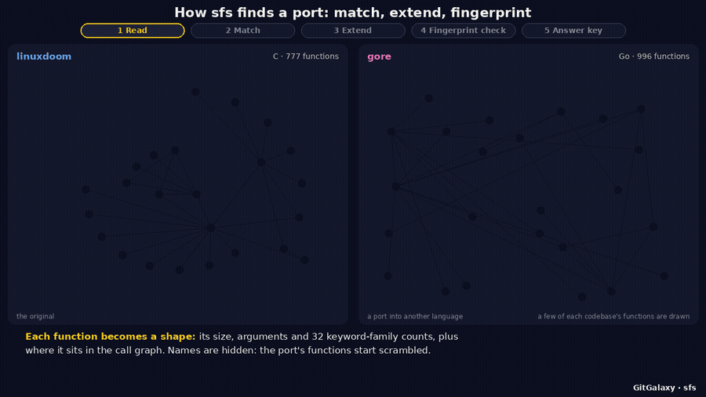
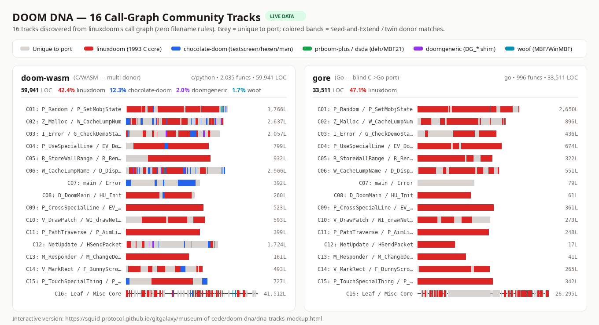

# structural-fingerprint-scanner

**Blind, two-layer structural homology and stylometry for codebases**, built on [GitGalaxy](https://github.com/squid-protocol/gitgalaxy) scans.

`structural-fingerprint-scanner` (`sfs`) compares repositories **without reading function names, comments, or file paths**. It pairs two complementary layers:

1. **Layer 1 — Macro-Topology (FGW + Seed-and-Extend):** Fused Gromov–Wasserstein (`FGW`) optimal transport over function geometry + hop-distance call graphs, followed by 3-hop call-graph extension. Recovers vertical source ports, cross-language translations, and horizontally borrowed modules.
2. **Layer 2 — Micro-Idiomatic Texture (32-Keyword-Family Lattice + `delta_lang`):** Distributional and per-matched-pair comparison across 32 structural signal families (branching, bitwise ops, pointer/state flux, encapsulation, I/O, etc.), with additive language-translation centering (`LanguageDeltaModel`) and linear style attribution (`StyleAxis`).

### How it works, shown: match, extend, fingerprint



Real scans, real output: linuxdoom (C, 777 functions) against gore, its Go port (996 functions). Names are hidden until
the last step.

1. **Read:** each function becomes a shape (size, arguments, 32 keyword families) at a place in its call graph.
2. **Match:** FGW optimal transport pairs functions whose shape *and* call-graph position agree. 439 pairs pick each
   other; only the strongest 15% are kept as anchors (66).
3. **Extend:** the C → Go offset is measured on the anchors. Then, for 3 hops, a caller or callee of a matched function
   is paired with its partner's unclaimed neighbour that is closest in shape. 66 → 276 → 482 → 598 matched (77%).
4. **Fingerprint:** each matched pair's keyword mix is compared. Pair by pair it separates the port from a Rust rewrite
   (cosine 0.74 vs 0.56); the codebase-wide mix cannot (JSD 0.39 vs 0.40).
5. **Answer key:** names, never used to match, grade it. 364 of 598 pairs are the same function: 62 of 66 anchors, then
   fewer with each hop. Shape alone, without the call graph, gets 220 of 329.

Details, caveats and how to regenerate: [`docs/media/README.md`](docs/media/README.md) ·
[MP4](docs/media/seed-extend.mp4)

It also provides **cohort fingerprinting**, **target–decoy structural twins**, **descent & profile trees**, **subsystem subway maps**, **git-history drift timelines**, and **scan-quality verification** (`ctags` / `tree-sitter` + LLM triage + PII-stripped GitGalaxy Epic issue reporting).

> **Featured Case Study — [DOOM's DNA: What Survives Translation, Porting, and Rewriting](https://squid-protocol.github.io/gitgalaxy/museum-of-code/teardown-of-doom/):**
> Validated blind across **44+ DOOM ports** (~20 languages), **9 controls**, and **5 held-out repos**. Explore the **[Interactive 16-Track DNA Gene Map](https://squid-protocol.github.io/gitgalaxy/museum-of-code/doom-dna/dna-tracks-mockup.html)** or the **[Interactive Function & Tree Explorer](https://squid-protocol.github.io/gitgalaxy/museum-of-code/doom-dna/)** on GitHub Pages.

---

## Install

```bash
# Core (Python 3.10+, numpy, scipy — works on pre-scanned *_galaxy_master.db or .sfp.json files)
pip install .

# With GitGalaxy auto-scanning for raw source repositories
pip install '.[scan]'

# With Tree-sitter quality verification (also auto-uses Universal Ctags if on PATH)
pip install '.[verify]'

# Development / tests
pip install '.[test]'

sfs --version
```

> **Note:** `pip install '.[scan]'` requires `gitgalaxy` to be reachable (via PyPI or `pip install git+https://github.com/squid-protocol/gitgalaxy.git`).

---

## Quickstart & Uses

### 1. Two-Layer Comparison (`sfs lattice-compare`)
Compare two pre-scanned DBs or raw source repositories (with `[scan]` installed):

```bash
sfs lattice-compare repo_a/ repo_b/ --lens portable --json
sfs lattice-compare repo_a/ repo_b/ --lens portable --matches --verify --issue-out epic.md
```

### 2. Scan Quality Verification & GitGalaxy Triage (`sfs quality`)
Guard against under-tuned language regexes or slicers before trusting downstream numbers:

```bash
# Check internal yield + optional ctags / tree-sitter recall
sfs quality repo_or_scan --source ./repo --verify

# Emit a disagreement cell list + LLM validation prompt (separates real gaps from parser noise)
sfs quality repo_or_scan --source ./repo --verify --triage-out triage.md

# Emit a copy-pasteable GitGalaxy Epic issue (standard or PII-stripped paranoid mode)
sfs quality repo_or_scan --source ./repo --verify --epic-issue --privacy paranoid --issue-out epic.md
```

### 3. Cohort Fingerprints, Twins, Subway Maps & Timelines

```bash
# Fingerprint scans (writes <name>.sfp.json + <name>.sfp.npz)
sfs fingerprint scans/ -o fingerprints/

# Compare a cohort: distances, twins, descent & profile trees, report.html
sfs compare fingerprints/ -o report/ --declared-lineage lineage.csv
sfs compare fingerprints/ -o report-portable/ --lens portable --no-twins

# Function-level structural twins (CSV)
sfs twins fingerprints/A.sfp.json fingerprints/B.sfp.json -o twins/

# Subsystem subway maps & cross-check
sfs subway fingerprints/ -o subway/ --reference A --taxonomy subsystems.json [--declared-lineage lineage.csv]

# Git-history drift timeline
sfs timeline --repo A=path/to/A --repo B=path/to/B --reference fingerprints/R.sfp.json \
    --engine /path/to/gitgalaxy --python /path/to/engine-venv/bin/python --every 1y -o timeline/

# Explain what separates two repositories & inspect the 37D reference frame
sfs explain fingerprints/A.sfp.json fingerprints/B.sfp.json
sfs spec [--lens portable] [--json]
```

### 4. Function Ledger (library: `structural_fingerprint.ledger`)

A persistent ID for every function across snapshots of one repository, so renames and moves are not counted as a
death plus a birth. Structure proposes a link; body text or comments verify it; each link records the stage that
made it. On four repositories, path-and-name identity overcounted deaths by 40–78%; lineage identity recovers
70–96% of unambiguous renames and 97–100% of moves (discovery measurements, not a registered result).

```python
from pathlib import Path
from structural_fingerprint.ledger import Snapshot, build_ledger, classify_unlinked

snaps = [Snapshot(Path("scans/q1.db"), "<commit sha>", "2024Q1"), ...]   # oldest first, one scan per commit
led = build_ledger(Path("path/to/git/checkout"), snaps)                    # reads git objects only
led.ids[s]            # lineage id of every function in snapshot s
led.links[s]          # old index -> Link(new, stage, score, ambiguous, body, doc)
led.span()            # lineage id -> (first, last) snapshot
dead, born = classify_unlinked(led, s)   # cause of each unlinked death/birth (split, merged, file_removed, ...)
```

Needs `start_line` and `docstring` in the scan database for text verification; without them only the certain
stages (identity, same name in the git-mapped file) link.

---

## Empirical Evidence

The two-layer pipeline has been validated across three benchmark programs (all blind to identifiers and file paths):

### 1. `doom-dna` — Lineage, Cross-Language Ports & Horizontal Borrowing
*Article: [DOOM's DNA (Text Edition)](https://squid-protocol.github.io/gitgalaxy/museum-of-code/teardown-of-doom/) · Interactive: [16-Track DNA Gene Map](https://squid-protocol.github.io/gitgalaxy/museum-of-code/doom-dna/dna-tracks-mockup.html) · [Function & Tree Explorer](https://squid-protocol.github.io/gitgalaxy/museum-of-code/doom-dna/) · Study repo: [`squid-protocol/doom-dna`](https://github.com/squid-protocol/doom-dna)*

[](https://squid-protocol.github.io/gitgalaxy/museum-of-code/doom-dna/dna-tracks-mockup.html)

*Click the preview above to open the **[Interactive 16-Track DNA Gene Map](https://squid-protocol.github.io/gitgalaxy/museum-of-code/doom-dna/dna-tracks-mockup.html)** across all 49 measured targets (`C01`–`C16` call-graph communities discovered directly from `linuxdoom`, zero filename rules). Above: `doom-wasm` exposes multi-donor horizontal borrowing (`42.4%` `linuxdoom` core in red, `12.3%` `chocolate-doom` in blue, `2.0%` `doomgeneric` in purple, `1.7%` `woof` in cyan), while `gore` recovers `47.1%` of Go LOC (`75.9%` 1-to-1 functions) from C without reading a single identifier.*

- **Within-language structural twins (`sfs twins`):** Achieves **93% precision** (65% recall) across `27,778` function-by-port pairs against source-text diffs (Spearman `ρ = 0.83–0.84`), while unrelated C controls (`lua`, `quake`, `quake2`) sit at `0.0%–0.6%`.
- **Clean port vs. scratch/unrelated separation (44+ ports, 9 controls, 66 cross-pairs):**
  - Unrelated controls (`lua` `0.0%`, `quake`/`quake2` `0.6%`, Go `goom3d`/`bubbletea`, Rust `macroquad`, C raycasters, business COBOL `carddemo-cobol-ctrl`) and from-scratch reimplementations (`room4doom`, `rust-doom`, `helion` all `0.0%`) sit at the noise floor, with **0–1 accidental name hits** across **66 cross-pair permutations**.
  - Layout-stripped and translated ports are recovered 1-to-1 by unsupervised Seed-and-Extend (`composition` mode + FGW + `delta` offset + 3-hop extension): `mood` (`95.3%`, `687/721`), single-header `puredoom` (`89.0%`, `590/663`), `doomgeneric` (`84.9%`, `547/644`), flat-directory Go port `gore` (`75.9%`, `426/561`, despite `0.2%` filename-taxonomy match), and `chocolate-doom` (`65.0%`, `433/666`).
- **Horizontal gene transfer:** Subtracting `linuxdoom` isolates Chocolate Doom's `textscreen` UI library inside `odamex` (`178/212` = `84.0%` Tier-1), `eternity` (`210/276` = `76.1%` Tier-1), `doom-wasm` (`220/271` = `81.2%` Tier-1), and directly between `eternity ↔ odamex` (`190/228` = `83.3%` Tier-1) across distinct DOOM branches.
- **Architectural clustering vs. syntax:** Three COBOL raycasters cluster at `FGW 0.670–0.706` vs. same-size enterprise business COBOL (`carddemo-cobol-ctrl`) at `0.748–0.775`.
- **Preregistered `DOOM-E5` held-out predictions:** Confirmed `cydoomgeneric` (`FGW=0.313`, `100.0%` = `156/156` Tier-1 vs. `doomgeneric`), `DOOM-style-Game` (`0.0%`), and `doome` (`0.0%`); falsifications on `iron-doom` (`0.0%`, `0/147`) and `doomarkable` (`0.0%`) pinpointed the paradigm boundary (below).

### 2. `agent-habits` — Model Fingerprinting & Language-Centered Style
- **Same-model runs resemble source forks (56 `confirm` runs):** Independent Sonnet runs (`FGW = 0.154–0.489`, `78.7%` Tier-1 / `68.1%` SE) match or exceed true C DOOM ports even with zero shared codebase ancestry.
- **32-keyword-family lattice (`-kw_JSD`):** Achieves **`0.944` ROC AUC** for same-model vs. different-model attribution within `(task, lang)`, outperforming FGW Seed-and-Extend (`0.874` AUC) and 14-archetype JSD (`0.655` AUC).
- **Additive language-translation centering (`delta_lang`):** Pure 32D translation matches or beats 32×32 Orthogonal Procrustes (`0.698` vs. `0.645` on held-out `chess`), and a language-centered `Claude Code vs. Codex CLI` vector transfers zero-shot to 16 held-out `explore/` scans at **`0.730` ROC AUC** (`6/7` within-`(task, lang)` pairs ordered `cc > codex`).

### 3. `keyword-rosetta` — Zero-Shot Cross-Language Translation Geometry
- Using 24-language centroids from `keyword-rosetta` (`language-crucible` v4.3.1 DB), predicting a port's 32-keyword-family profile as `linuxdoom + (rosetta[lang] - rosetta["c"])` reduces JSD across all 5 tested cross-language DOOM translations:
  - `mochadoom` (`java`): `0.358 → 0.193` (`-0.165`)
  - `doomf77` (`fortran`): `0.353 → 0.253` (`-0.100`)
  - `managed-doom` (`csharp`): `0.332 → 0.273` (`-0.059`)
  - `gore` (`go`): `0.329 → 0.273` (`-0.056`)
  - `dartdoom` (`dart`): `0.350 → 0.302` (`-0.048`)
- Conversely, general-purpose Rosetta centroids do *not* improve subtle cross-language model attribution on `chess`/`sat` (`0.660 → 0.601`), showing that coarse translation shifts transfer universally while fine model-style residuals need domain-matched `delta_lang`.

---

## Limits & Measured Accuracy Floors

### Structural Limits
- **Paradigm shifts:** `C → Go` (`gore`, `75.9%`) preserves imperative call-graph DNA, whereas `C → Bevy ECS` (`iron-doom`, `0.0%`) replaces the call graph with decoupled ECS systems and drops to the from-scratch floor.
- **Externalized wrappers:** Thin platform wrappers around external crates (`doomarkable`, 41 functions) lack the vendored engine call graph (`0.0%`).
- **Uncentered cross-domain attribution:** Comparing `kw_JSD` directly across unrelated domains (e.g. `raycaster` vs. `chess`/`sat` COBOL) is confounded by task structure unless language/domain offsets are centered.

### Degradation & Resilience Asymmetry (DOOM Ablation)
Controlled ablations against `linuxdoom` (`doomgeneric`, `gore`, `rust-doom`) show that Layer 1 and Layer 2 fail in opposite ways:

| Failure Mode | Layer 1 (`FGW Seed-and-Extend`) | Layer 2 (`32-Keyword Lattice`) |
|---|---|---|
| **Missing functions** | Same-lang C holds `>80%` T1 through `50%` loss (cliff at `75%` drop); cross-lang Go drops below `50%` T1 at `50%` loss | **Resilient** (`kw_JSD` flat `0.101–0.109` up to `90%` drop) |
| **Missing call edges** | Same-lang C holds `>70%` T1 through `75%` loss; cross-lang Go drops below `50%` T1 at `50%` loss | **Resilient** |
| **Missing keyword signals** | **Resilient** (`98.7%` C / `91.5%` Go T1 even with `90%` signal columns zeroed) | **Sensitive** (`doomgeneric` `kw_JSD` jumps `0.104 → 0.392` at `25%` loss and `0.748` at `50%` loss) |

This asymmetry is why `sfs quality --verify` gates on **both** parser function recall (`ctags` / `tree-sitter`, protecting Layer 1) **and** zero-signal rate (protecting Layer 2).

---

## Perspectives: How Different Reviewers Read This Evidence

| Reviewer Lens | What Stands Out | Caveat / Boundary Noted |
|---|---|---|
| **Clean-Room & IP Forensics** | `93%` twin precision on stripped code (`puredoom` `89.0%`, `gore` `75.9%`) and exact isolation of horizontally vendored modules (`textscreen` in `eternity`/`odamex`/`doom-wasm`) while keeping `0–1` false hits across `66` non-DOOM cross-pairs and `9` controls. | Structural homology flags *candidate* ancestry; as `agent-habits` proves (`0.154–0.489` FGW across independent Sonnet runs), shared model/idiom habits can mimic fork-level topology without copying. |
| **Compiler & Static Analysis** | True two-layer orthogonality: ablating `50%` of functions/edges drops Layer 1 below `50%` on Go while Layer 2 `kw_JSD` stays flat (`0.101–0.109` up to `90%` drop); zeroing keyword signals breaks Layer 2 (`0.104 → 0.748`) while Layer 1 holds (`98.7%` C / `91.5%` Go). | Tiny-function OOP splitting (`34%` of `mochadoom` and `43%` of `kocoa-doom` `<= 3` LOC) distorts unsmoothed `hits/loc`, requiring `composition` mode and `sfs quality --verify`. |
| **Legacy Modernization & Architecture** | Imperative cross-language translations (`C → Go` `gore`, `+0.50` cross-subsystem wiring) preserve call-graph DNA, and COBOL raycasters separate cleanly from business COBOL (`FGW 0.670–0.706` vs. `0.748–0.775`). | Paradigm shifts (`C → Bevy ECS` in `iron-doom`, `0.0%`) and thin external-crate wrappers (`doomarkable`, `0.0%`) erase the call-graph signature even when ported from a known ancestor. |
| **Empirical Methodology / Skeptic** | Preregistered held-out predictions (`DOOM-E5`), explicit negative controls (`9` controls + `66` cross-pairs), and documented non-separators (raw graph-shape distance `0.30–3.25` vs. `1.04–2.30` fails without nulls). | Uncentered `kw_JSD` confounds task domain with author style unless offset by `delta_lang`, and blind wiring must be evaluated by placement agreement rather than imposed post-hoc. |

---

## GitHub Action

[`action.yml`](action.yml) provides a composite GitHub Action that installs `structural-fingerprint-scanner[scan]`, runs `sfs lattice-compare` on two repositories or scan directories, and emits `fgw-cost`, `se-coverage`, `kw-jsd`, and `json` outputs plus a step summary:

```yaml
- uses: squid-protocol/structural-fingerprint-scanner@v0.1.0
  with:
    repo-a: ./baseline
    repo-b: ./candidate
    lens: portable
```

---

## Reference Frame, Docs & Tests

- [docs/METHOD.md](docs/METHOD.md) specifies formulas, calibration, and limits; [examples/doom/](examples/doom/) contains the 44-port DOOM reference dataset.
- The vendored reference model (`src/structural_fingerprint/data/`) records the GitGalaxy commit (`spec_hash`) used to normalize the 37D feature frame.

```bash
pytest
# Engine parity on real scans:
SFS_REAL_SCANS=/path/to/scans pytest
```

## License

Licensed under the [PolyForm Noncommercial License 1.0.0](LICENSE).
