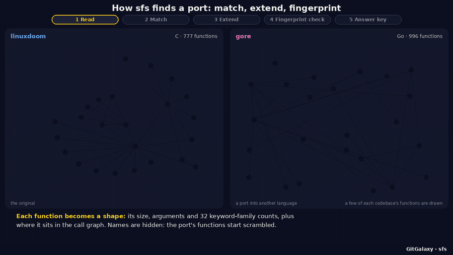

# How sfs finds a port, shown



[GIF](seed-extend.gif) · [MP4](seed-extend.mp4) · [final frame](seed-extend.png)

One film of `sfs lattice-compare` (`lattice.seed_and_extend_with_lattice`) at work on two real scans, both scanned by
GitGalaxy for the DOOM study:
- **linuxdoom** (id Software's original C, 777 functions of 3+ lines);
- **gore**, a Go port of it (996 functions).

**Every number and every function drawn comes from the run.** `tools/media/seed_extend_data.py` replays the
algorithm step by step to keep the intermediates the library discards. It refuses to write anything unless its final
pairs and seed count equal the library's own result. The drawing shows a few of each codebase's functions: two real
anchors and the real matches that grew from them, plus some neighbours that never got a partner.

## The steps

1. **Read.** Each function becomes a shape:
   - its size, arguments and 32 keyword-family counts;
   - where it sits in its call graph (hop distances).

   Names are hidden, and the port's functions start scrambled.
2. **Match.**
   - Fused Gromov–Wasserstein optimal transport pairs functions whose shape *and* call-graph position agree.
   - 439 linuxdoom functions and their best gore partner pick each other (reciprocal best). Rings mark the drawn ones.
   - Only the strongest 15% are kept as **anchors**: 66.
3. **Extend.**
   - **Offset.** The median difference between the anchor pairs is the C → Go offset. It is subtracted before
     comparing shapes. Here, C functions are longer (+0.39 log lines) and use more pointers (+0.14).
   - **Hops.** Then, three times, a caller or callee of a matched function is paired with its partner's unclaimed
     caller or callee that is closest in shape, with +0.1 for each matched neighbour the two share.
   - **Growth.** Matched functions go 66 → 276 → 482 → 598, 77% of linuxdoom.
   - **Where it stops.** Functions whose neighbours offered no partner stay grey.
4. **Fingerprint.** Each matched pair's 32-family keyword mix is compared (cosine). The same steps on **rust-doom**, a
   from-scratch Rust engine with no declared lineage, give the contrast:

   | | gore (Go port) | rust-doom (Rust rewrite) |
   |---|---:|---:|
   | anchors | 66 | 19 |
   | functions matched | 77% | 21% |
   | pair keyword cosine (median) | 0.74 | 0.56 |
   | same archetype | 89% | 62% |
   | same top family | 42% | 13% |
   | whole-codebase keyword mix (JSD) | 0.39 | 0.40 |

   The codebase-wide mix cannot tell the port from the rewrite. Compared pair by pair along the matches, it can.
5. **Answer key.** Names, never used to match, grade every pair. 364 of 598 pairs are the same function:

   | step | pairs | same function | wrong | no same-named function |
   |---|---:|---:|---:|---:|
   | anchors | 66 | 62 | 3 | 1 |
   | hop 1 | 210 | 145 | 60 | 5 |
   | hop 2 | 206 | 105 | 74 | 27 |
   | hop 3 | 116 | 52 | 46 | 18 |

   Accuracy falls with every hop.

## How much each step helps (same pair, same answer key)

| what is matched | pairs | same function |
|---|---:|---:|
| random one-to-one pairing | 777 | 0 |
| shape alone: reciprocal nearest neighbour on the same descriptors, no call graph | 329 | 220 |
| shape + call-graph position (FGW), all reciprocal best | 439 | 267 |
| … only the strongest 15% (anchors) | 66 | 62 |
| anchors + 3 hops of extension | 598 | 364 |
| the same, without the language offset | 604 | 365 |

The language offset barely matters for this pair (364 vs 365); the film says so. Its job is pairs whose languages
differ more in shape.

## Caveats

- **Answer key.** The key is name-based:
  - same name ignoring case and underscores;
  - also after dropping one short module prefix the port added (gore writes `IdentifyVersion` as
    `d_IdentifyVersion`), like copyfinding's `ossl_` rule.

  A pair whose linuxdoom name has no counterpart in gore is "no same-named function", not wrong.
- **One pair.** This is one pair of codebases. The rust-doom row is a single contrast, not a null distribution.
- **Shape, not behaviour.** The film measures code shape, not behaviour.
- **Licences.** linuxdoom and gore are GPL-2.0 projects. Only function names and counts appear here, no code.

## Regenerate

The data step needs only the scanner's dependencies. The film needs Pillow and ffmpeg (or the `imageio-ffmpeg`
wheel, whose bundled binary is used when `ffmpeg` is not on PATH).

```bash
python tools/media/seed_extend_data.py --a <scans>/linuxdoom --b <scans>/gore --out docs/media/seed-extend-data.json
python tools/media/seed_extend_data.py --a <scans>/linuxdoom --b <scans>/rust-doom --summary-only \
    --out docs/media/seed-extend-contrast.json
python tools/media/seed_extend_explainer.py --data docs/media/seed-extend-data.json \
    --contrast docs/media/seed-extend-contrast.json --out docs/media/seed-extend
```

`<scans>` is the DOOM study's scan directory at engine `9f213ab83`. The rendered data is committed beside the film,
so the film re-renders without the scans.
